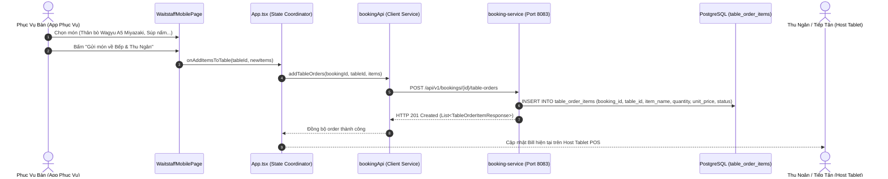

# TÀI LIỆU HIỆN THỰC UC-31: APP PHỤC VỤ TẠI BÀN DI ĐỘNG (MOBILE WAITSTAFF ORDERING & ACTIONS)

> **Mã Use Case:** UC-31  
> **Tên Use Case:** App Phục Vụ Tại Bàn Di Động (Mobile Waitstaff Ordering & Actions)  
> **Phân hệ phụ trách:** Booking & Dispatch Service (:8083), Restaurant Service (:8082), Mobile POS UI  
> **Thành viên thực hiện:** Duy Đào (Module 3)  
> **Giao diện người dùng:** [`WaitstaffMobilePage.tsx`](file:///d:/SBA301/Projec_Cuoi_Ki/src/client/tablemaster-ui/src/views/WaitstaffMobilePage.tsx), [`HostTabletPage.tsx`](file:///d:/SBA301/Projec_Cuoi_Ki/src/client/tablemaster-ui/src/views/HostTabletPage.tsx)

---

## 1. Nghiệp Vụ Nhân Viên Phục Vụ Tại Bàn (In-Dining Operations)

Thiết bị cầm tay (Smartphone/Mobile POS / Tablet) của nhân viên phục vụ bàn cung cấp toàn bộ công cụ thao tác theo thời gian thực:
1. **Thanh chọn bàn ngang (Horizontal Table Selector):** 
   - Hiển thị danh sách các bàn đang phục vụ theo màu sắc: Xanh lá (`AVAILABLE`), Tím (`CONFIRMED`), Xanh dương (`SEATED` - Đang ăn).
   - Hiển thị tên khách, số lượng khách và giá trị hóa đơn tạm tính theo thời gian thực.
2. **Gọi món tại bàn (In-table Ordering):**
   - Tải danh mục thực đơn động từ backend `restaurant-service` (cổng 8082): Bò Steak Thượng Hạng, Rượu Vang & Đồ Uống, Khai Vị & Salad, Tráng Miệng.
   - Thêm món vào khay order, tùy biến ghi chú pha chế và độ chín steak (Medium Rare, Không cay, Thêm sốt tiêu đen...).
3. **Nhập món riêng ngoài menu:** 
   - Hỗ trợ nhập món theo yêu cầu ẩm thực đặc biệt hoặc phụ thu dịch vụ của khách cùng đơn giá và số lượng.
4. **Bắn Order Về Bếp KDS & Lưu PostgreSQL:**
   - Chạm nút **"Gửi Món Về Bếp & Thu Ngân"**, hệ thống gọi API lưu toàn bộ món vào bảng `table_order_items` trong database `tablemaster_booking`.
   - Bắn thông báo thời gian thực sang màn hình Bếp [`KitchenKdsPage.tsx`](file:///d:/SBA301/Projec_Cuoi_Ki/src/client/tablemaster-ui/src/views/KitchenKdsPage.tsx) với trạng thái ban đầu là `PREPARING`.
5. **Thao tác nhanh tại bàn:** 
   - Chuyển bàn ([UC-19](file:///d:/SBA301/Projec_Cuoi_Ki/doc/booking/UC19_TABLE_REASSIGNMENT_IMPLEMENTATION.md)).
   - Ghép bàn ([UC-20](file:///d:/SBA301/Projec_Cuoi_Ki/doc/booking/UC20_SMART_TABLE_MERGING_IMPLEMENTATION.md)).

---

## 2. Kiến Trúc Kỹ Thuật & Luồng Dữ Liệu Gọi Món Tại Bàn



---

## 3. Đặc Tả Bảng Dữ Liệu `table_order_items` (PostgreSQL)

Mọi món gọi thêm trong suốt thời gian khách ngồi ăn tại bàn được quản lý tại bảng `table_order_items` thuộc cơ sở dữ liệu `tablemaster_booking`:

```sql
CREATE TABLE table_order_items (
    id UUID PRIMARY KEY DEFAULT uuid_generate_v4(),
    booking_id UUID NOT NULL REFERENCES bookings(id) ON DELETE CASCADE,
    table_id UUID NOT NULL,
    menu_item_id UUID,                     -- Tham chiếu món từ restaurant-service (hoặc NULL nếu là món tự nhập)
    item_name VARCHAR(150) NOT NULL,       -- Tên món hiển thị
    quantity INT NOT NULL CHECK (quantity > 0),
    unit_price DECIMAL(12, 2) NOT NULL,   -- Đơn giá tại thời điểm gọi
    status VARCHAR(30) NOT NULL DEFAULT 'PREPARING', -- PREPARING, SERVED, CANCELLED
    notes TEXT,                            -- Ghi chú chế biến riêng cho Bếp
    ordered_by_user_id UUID,               -- Nhân viên phục vụ bấm order
    created_at TIMESTAMP WITH TIME ZONE DEFAULT CURRENT_TIMESTAMP
);

CREATE INDEX idx_table_order_items ON table_order_items(booking_id, table_id, status);
```

---

## 4. Đặc Tả REST API Gọi Món & Đồng Bộ Hóa

### 4.1. Thêm Món Vào Bàn Đang Ngồi (In-Dining Orders)
* **Phương thức:** `POST /api/v1/bookings/{id}/table-orders`
* **Headers:** `X-User-Id: <UUID nhân viên phục vụ>`
* **Request Body:**
```json
{
  "tableId": "b3000000-0000-0000-0000-000000000001",
  "items": [
    {
      "menuItemId": "b5000000-0000-0000-0000-000000000003",
      "itemName": "Súp Nấm Truffle Đen & Bánh Mì Bơ Tỏi",
      "quantity": 1,
      "unitPrice": 320000.00,
      "notes": "Ít cay"
    }
  ]
}
```
* **Điều kiện nghiệp vụ:** Đơn đặt bàn bắt buộc phải ở trạng thái `SEATED`. Nếu chưa check-in sẽ trả về lỗi `400 Bad Request`.

### 4.2. Lấy Danh Sách Món Tại Bàn Để Tính Tiền Realtime
* **Phương thức:** `GET /api/v1/bookings/{id}/table-orders`
* **Mục đích:** Tự động khôi phục và đồng bộ danh sách món từ DB khi tải lại trang hoặc mở lại bàn trên thiết bị khác:
```json
{
  "success": true,
  "message": "Thành công",
  "data": [
    {
      "id": "8b299926-6ec9-488d-91ae-611d90684e18",
      "bookingId": "c2d6724f-af9e-43e3-ae4b-387907e04b3e",
      "tableId": "b3000000-0000-0000-0000-000000000001",
      "itemName": "Súp Nấm Truffle Đen & Bánh Mì Bơ Tỏi",
      "quantity": 1,
      "unitPrice": 320000.00,
      "status": "PREPARING",
      "createdAt": "2026-11-10T14:14:31.202333Z"
    }
  ]
}
```

---

## 5. Chu Trình Thanh Toán & Giải Phóng Bàn (Checkout & Complete)

1. Khi khách gọi thanh toán, Lễ tân/Thu ngân mở thẻ bàn trên **Host Tablet POS**.
2. **Khấu trừ tiền cọc tự động:**
   $$\text{Tiền cần trả} = \max(0, \text{Tổng tiền món} + \text{Phí phục vụ 5\%} - \text{Tiền cọc VietQR đã chuyển trước})$$
3. Thu ngân chọn hình thức thanh toán (Tiền mặt / Quẹt thẻ POS / VietQR).
4. Hệ thống gọi `POST /api/v1/bookings/{id}/complete`:
   - Chuyển `bookings.status` thành **`COMPLETED`**.
   - Ghi nhận mốc thời gian hoàn tất: `completed_at = NOW()`.
   - Trả trạng thái bàn về màu **Xanh lá (`AVAILABLE`)**, sẵn sàng đón lượt khách tiếp theo.
